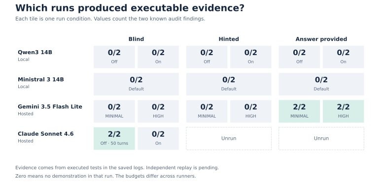
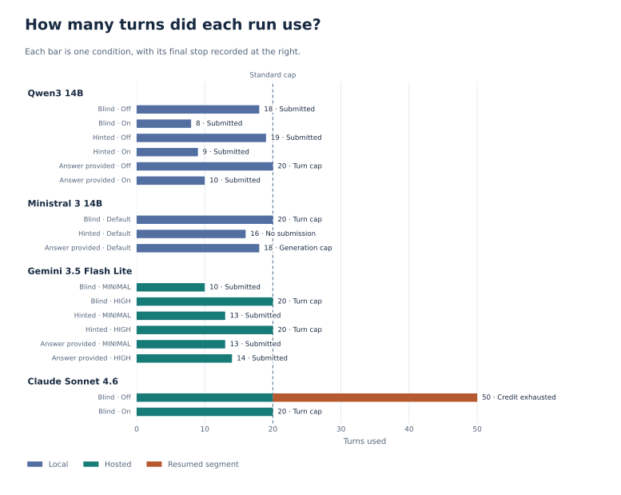

# SORO-SCONE-bench

**A local-first benchmark for finding and reproducing real vulnerabilities in Stellar Soroban contracts.**

Can an open-weight model running on a workstation find a real smart-contract bug and write a test that demonstrates it? How much does its performance change when it gets a hint or the answer? I built this project to explore those questions, using two confirmed findings from a public Soroban audit I worked on.

The pilot compares two local models with two hosted models. The clearest result came from a run that ended without a final report. Claude found both bugs in blind mode and executed tests for both before its API credit ran out. The command logs captured evidence that a score based solely on reports would have missed.

## Motivation

The project started after an expert panel hosted by Nepal Rastra Bank (NRB) discussed whether Nepal should develop a central bank digital currency (CBDC). I wanted to explore a practical security question raised by that discussion. If Nepal built such a system, how useful would locally hosted AI be for finding flaws in its software?

Financial data residency in Nepal was a design constraint for the question I wanted to study. An audit workflow can handle sensitive inputs beyond transaction records, including unreleased source code, test fixtures, execution logs, and vulnerability reports. Hosting inference locally lets a team choose where those artifacts are processed and stored. For this pilot I used public contract code and published findings, which also let me compare local models with hosted APIs without using customer records. The benchmark studies model capability under that deployment constraint. It does not evaluate the legal compliance of a CBDC or a hosting arrangement.

I had worked on the Scaffold Registry audit, so Soroban gave me a concrete starting point. I could take bugs with documented fixes, pin both revisions, and check whether a generated test exposed the original behavior. The registry is a case study in auditing financial infrastructure code. The CBDC discussion motivated the research question.

## Inspiration from SCONE-bench

SCONE-bench, by Winnie Xiao, Cole Killian, Henry Sleight, Alan Chan, Nicholas Carlini, and Alwin Peng, evaluates agents against contracts involved in historical exploits and measures the results in simulation. I borrowed the idea of having an agent **show its work through execution**. Here, the cases come from confirmed audit findings in Soroban's Rust and Wasm environment. A reproduction succeeds by showing a specific contract behavior, such as a lookup returning an older release's hash. [SCONE-bench research write-up](https://www.anthropic.com/research/smart-contracts)

## The benchmark case

**Scaffold Registry** lets users publish named, versioned Wasm binaries and look up their hashes. The Veridise audit covered revision `142ee6f`. Both findings in this pilot were fixed at `56e2035`.

| Finding | What went wrong | What the reference test checks |
| --- | --- | --- |
| `V-AHA-VUL-001` | `most_recent_version()` selects the first map key. That can return an older version and make the version check compare new releases against the wrong baseline. | After publishing `1.0.0` and then `2.0.0`, the current version should be `2.0.0`. |
| `V-AHA-VUL-002` | `fetch_hash()` without a version selects the last value in string-key order. In that ordering, `1.10.0` comes before `1.9.0`, even though it is newer by semantic version. | After publishing both versions with distinct hashes, the default lookup should return the hash for `1.10.0`. |

I wrote reference tests and ran them against both revisions. Each failed at the expected assertion on the audited code and passed on the fixed code. This established the two behaviors I would score before running the models. Both bugs arise from the same underlying mismatch between map order and version order, so they provide two distinct observations of a closely related failure mode.

## How the experiment works

The Python harness starts each attempt with a fresh conversation and a fresh Docker container built from the audited snapshot. The agent can list and read files, execute shell commands, edit the source or tests, and submit a structured report. Containers have networking disabled and run with restricted privileges and resource limits. The host runner handles inference separately, through Ollama for local models or the configured provider API.

The study keeps the initial audit task fixed and varies the information disclosed to the model.

| Mode | What the agent receives | What it tests |
| --- | --- | --- |
| **Blind** | The code and a general audit task. | Can it identify and demonstrate the issue from the project? |
| **Hinted** | The same task and a clue to investigate version publishing and retrieval. | Can it use a narrower search area to form and test the right hypothesis? |
| **Answer provided** | The known findings and example inputs, with the reference test code kept outside the container. | Can it translate a correct diagnosis into a test it can run? |

The harness saves the original task, run configuration, model responses, tool calls, command outputs, and any final report. API runners also save a project archive so model-written tests can be examined after the container exits. Claude's continuation runner can restore a saved project and conversation when a run stops partway through.

I read the reports and execution logs together and assess three things separately.

1. **Identification.** Did the model describe the actual root cause and incorrect behavior? In answer-provided mode, that information was already disclosed.
2. **Executable evidence.** Did a newly written test actually run and expose the behavior? A passing test that asserts the bug and a failing test that asserts the correct behavior can both be evidence. A compilation error or a command matching zero tests gives no such evidence.
3. **Completion.** Did the model submit a report? A report can claim findings without a demonstration, and a stopped run can contain a useful demonstration.

The reference tests were replayed on both revisions. The model-written demonstrations in the results below were reviewed against their in-run logs. Independent replay of those demonstrations in clean containers against both revisions remains a separate check.

## Why these models

I used the hardware I had available, a Ryzen 7 7700 workstation with an RTX 5070 Ti and 16 GB of VRAM, running Ollama in WSL with roughly 16 GB of system memory available to WSL. That shaped the local model selection. I chose 14B-class Ollama builds that were practical to run on that machine. The local study used a configured 16,384-token context and up to 8,192 output tokens per turn. The results reflect those model builds and that setup.

| Model | Where it ran | Why I included it |
| --- | --- | --- |
| **Qwen3 14B** (`qwen3:14b`) | Local Ollama | An open-weight model that fit the workstation and let me compare thinking on and off. |
| **Ministral 3 14B** (`ministral-3:14b`) | Local Ollama | A second practical open-weight model at a similar size. I ran the configuration supported by my Ollama setup. |
| **Gemini 3.5 Flash Lite** (`gemini-3.5-flash-lite`) | Hosted API | A low-cost baseline I could run on the free tier available to me. I tried its MINIMAL and HIGH reasoning settings. |
| **Claude Sonnet 4.6** (`claude-sonnet-4-6`) | Hosted API | A comparison with a paid hosted model using a small API credit balance. |

The experiment compares setups that were accessible to me. It asks whether keeping inference local on this workstation was practical for the task, and what a low-cost or free hosted option could do on the same code. It does not measure the full cost of operating local infrastructure.

## What happened

Qwen and Gemini each ran six conditions, combining the three disclosure modes with two reasoning settings. Ministral ran three conditions at its supported setting. The Claude comparison covers two blind attempts, one of which continued from saved state. Earlier API setup stops are kept separate from these results.

| Model | Blind | Hinted | Answer provided |
| --- | --- | --- | --- |
| **Qwen3 14B** | Neither known bug demonstrated. | Thinking on surfaced a partial diagnosis of the version selection bug. No new test demonstrated it. | Repeated the disclosed findings with thinking on. The commands matched zero tests. |
| **Ministral 3 14B** | Attempted tests for other issues. Neither target bug demonstrated. | Ran the existing tests and stopped without a demonstration. | Wrote candidate reproductions for both findings. Compilation errors blocked execution. |
| **Gemini 3.5 Flash Lite** | Neither reasoning setting demonstrated either bug. | MINIMAL described the wrong-hash behavior without running a new test. HIGH attempted tests for both findings, but compilation failed. | **Both bugs demonstrated** under MINIMAL and HIGH. |
| **Claude Sonnet 4.6** | **Both bugs demonstrated** in the extended thinking-disabled run. The thinking-enabled run reached 20 turns without a demonstration. | Unrun | Unrun |



Each tile shows one run condition and the number of known findings supported by an executed test. The shaded successes reflect in-run evidence. Fresh replay against both revisions remains pending.

### Seeing the bug and proving it were different tasks

Gemini MINIMAL's hinted report selected `no_confirmed_findings` yet correctly explained why `1.9.0` could be selected over `1.10.0`. I counted that as recognition of the hash bug and kept execution credit separate. Gemini's answer-provided runs produced actual tests. MINIMAL used a combined test for the two behaviors. HIGH fixed a compilation error in its first attempt and then ran separate demonstrations successfully.

The local runs showed a different bottleneck. Qwen could discuss the supplied findings, but its test commands did not execute the proposed tests. Ministral got as far as writing candidate tests and hit Rust and contract-client errors. Those outcomes helped distinguish knowing what to check from being able to make the check run in the real project.

### Claude's report was incomplete, but its tests ran

Claude's thinking-disabled blind attempt initially stopped at 20 turns. It had noticed a discrepancy in version selection without yet testing it. I restored the saved conversation and project state and continued for another 30 turns. This was one continuous investigation, with **50 turns total**.

In the continuation, Claude wrote a test showing that `current_version()` returned `0.0.1` after it had published `0.0.3`. A second test published `0.0.9` and `0.0.10` with distinct hashes. It failed on the expected newest-hash assertion, and its output showed that the actual result matched the hash for `0.0.9`.

The API then rejected a request for insufficient credit, before Claude submitted a final report. The runner's ledger accounted for about **\$4.45** across that original run and its continuation. That figure is the harness's accounting for this investigation. The run's evidence is the executed tests and their outputs.



The orange segment shows Claude's continuation. The two segments are counted as one attempt. The figures use the [reviewed run summary](results/pilot-runs.csv), which contains outcomes and evidence notes for all 17 pilot attempts.

## Scope and limitations

- **Two related findings in one contract.** This is a personal research pilot. It gives concrete examples of audit-agent behavior on one Soroban codebase. The tests cover version reporting and hash selection, with neither a CBDC deployment nor a measurement of financial loss.
- **Different run budgets.** The standard study used a 20-turn cap. The API runners used a separate 32,768-token input allowance, while the local runner used the configured Ollama context. Claude's continuation had a larger effective allowance. A controlled ranking would need matched budgets and repeated attempts.
- **The harness affects what gets measured.** Early API runs exposed context accounting and configuration problems. I corrected the harness and kept those stops separate from findings about the model. Claude's hinted and answer-provided conditions were left unrun.
- **Public examples can be familiar.** Blind mode withholds findings from the task input. The public code and audit report may already be familiar to a model through training.
- **In-run evidence and independent replay are distinct.** The recorded tests provide evidence for the reported behaviors. Replaying each model's test against clean audited and fixed snapshots would check that it depends on the bug and can be reproduced outside the original agent session.
- **Hardware and tooling matter.** My GPU, available memory, model builds, and tool interface constrained the local runs. The study covers those configurations and leaves larger local models and other scaffolds for follow-up work.

## Run the pilot

From the repository root, preview the local study condition:

```bash
python3 -m runner.local.run_study \
  --model qwen3:14b --mode blind --thinking on --dry-run
```

A live local run needs Python, Docker, and Ollama serving the selected model. The public repo contains the harness, study configuration, and reviewed results. To prepare the input, point `AUDITED_CHECKOUT` at a local checkout of the Scaffold Registry repository containing commit `142ee6f`. Extract that revision into an empty input directory:

```bash
AUDITED_CHECKOUT=/path/to/scaffold-stellar
INPUT=benchmarks/aha-registry-002/input
mkdir -p "$INPUT"
git -C "$AUDITED_CHECKOUT" archive 142ee6f | tar -x -C "$INPUT"
```

Build the image using the tag from the study protocol:

```bash
ollama pull qwen3:14b

IMAGE_TAG=$(python3 -c 'import json; print(json.load(open("study/v1/protocol.json"))["image"])')
docker build -f runner/Dockerfile -t "$IMAGE_TAG" \
  benchmarks/aha-registry-002/input
```

Remove `--dry-run` to execute the condition. Use a new `--attempt` number when repeating one already recorded. The Gemini and Claude study launchers reuse the saved task from a matching Qwen study run. Generate the corresponding local condition first when starting from a clean clone. Provider setup and the continuation command are documented in [runner/README.md](runner/README.md).

| Path | What to look for |
| --- | --- |
| `benchmarks/aha-registry-002/` | Local audited snapshot and reference validation material. |
| `runner/local/`, `runner/gemini/`, `runner/claude/` | The provider-specific agent, client, and study launcher code. |
| `study/` | Prompts, disclosures, model conditions, and run budgets. |
| `results/pilot-runs.csv` | Published summary of run conditions, evidence, and stops. |
| `docs/figures/` | Figures generated from the reviewed summary. |
| `runs/<run-id>/` | Local run logs, submitted reports, and project archives. |

The repo's ignore rules keep credentials, contract snapshots, raw runs, and local archives out of the default Git staging set. The published CSV contains reviewed findings and stop reasons without source snapshots or command transcripts. To regenerate the figures, install Matplotlib and run `python3 -m runner.plot_results` from the repo root.

## What I want to test next

I want to see whether giving a local model better code context can help it get from suspicion to a running test. The next experiment would keep the model and budget fixed, vary how the agent retrieves relevant source, and replay any produced tests against the audited and fixed versions. Additional Soroban audit cases would show whether that improvement carries over to bugs beyond version ordering.

**Aayushman Thapa Magar**
